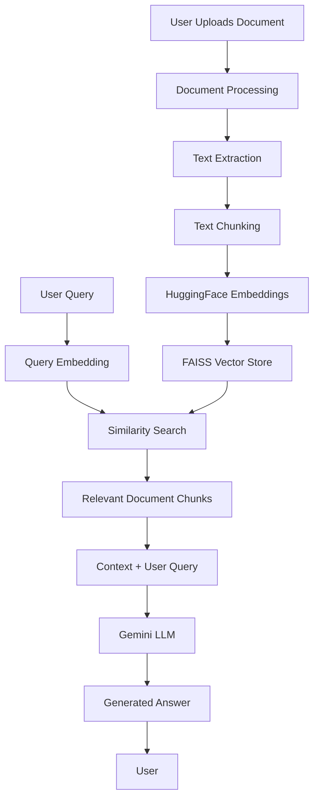

# RAG AI Knowledge Assistant

A document-based AI assistant built using **Retrieval-Augmented Generation (RAG)** that allows users to upload documents, retrieve relevant information using semantic search, and generate context-aware answers with the help of Google's Gemini LLM.

The project combines local vector embeddings and similarity search with a generative AI model to make document-based question answering more useful and grounded in provided information.

---

## Overview

Large Language Models can generate impressive responses, but they may sometimes produce incorrect information, lack access to private documents, or rely on outdated knowledge.

This project explores how Retrieval-Augmented Generation can address these limitations by connecting an LLM with an external knowledge source.

Instead of asking the language model to answer a question using only its pre-trained knowledge, the system:

1. Accepts a document from the user.
2. Extracts its text content.
3. Divides the text into smaller chunks.
4. Generates embeddings for each chunk.
5. Stores the embeddings in a FAISS vector index.
6. Retrieves relevant chunks when a user asks a question.
7. Passes the retrieved context to Gemini.
8. Generates a response based on the retrieved information.

The goal is to understand and implement the complete RAG workflow, from document ingestion to context-aware answer generation.

---

## Architecture



### RAG Pipeline

The application consists of two major stages:

**1. Document Ingestion**

Uploaded documents are processed and divided into smaller text chunks. Each chunk is converted into a numerical vector using a HuggingFace embedding model and stored in a FAISS index.

**2. Retrieval and Generation**

When a user submits a question, the system performs semantic similarity search against the stored vectors. The most relevant chunks are retrieved and provided to Gemini as context for generating the final response.

---

## Tech Stack

| Technology | Purpose |
|---|---|
| Python | Core programming language |
| FastAPI | Backend framework and REST API |
| LangChain | Integration and orchestration of RAG components |
| HuggingFace Sentence Transformers | Text embedding generation |
| `all-MiniLM-L6-v2` | Embedding model |
| FAISS | Vector storage and similarity search |
| Google Gemini | Context-aware response generation |
| Uvicorn | ASGI server |
| python-dotenv | Environment variable management |

---

## Project Structure

```text
rag-ai-knowledge-assistant/
│
├── main.py
│
├── routes/
│   ├── upload.py
│   ├── query.py
│   └── chat.py
│
├── services/
│   ├── vector_store.py
│   ├── retriever.py
│   └── rag_pipeline.py
│
├── faiss_index/          # Generated locally
│
├── .env                 # API keys (not committed)
├── .gitignore
├── requirements.txt
└── README.md
```

> The exact structure may vary depending on the current implementation. The FAISS index is generated locally when documents are processed.

---

## How It Works

### 1. Document Upload and Processing

The user uploads a document through the API. The backend extracts the text and prepares it for processing.

Large documents are divided into smaller chunks because embedding an entire document as one unit can reduce retrieval precision. Chunking allows the system to identify smaller sections that are more closely related to a user's question.

### 2. Embedding Generation

Each text chunk is converted into a vector representation using the Sentence Transformers model:

`all-MiniLM-L6-v2`

Embeddings capture semantic information about the text, allowing the system to identify related content even when the query does not contain the exact words used in the document.

### 3. Vector Storage with FAISS

The generated embeddings are stored in a FAISS index.

FAISS enables efficient similarity search by comparing the vector representation of a query with the vectors stored in the database. It helps retrieve relevant document chunks without searching through the entire text manually.

### 4. Semantic Retrieval

When a question is submitted, the system searches the vector store for chunks that are semantically similar to the query.

The retriever returns the most relevant content, which acts as the knowledge context for the language model.

### 5. Answer Generation with Gemini

The retrieved information and user query are combined into a prompt and passed to the Gemini model.

The LLM uses the retrieved context to generate a relevant response, allowing the answer to be based on the uploaded document rather than solely on its general training knowledge.

---

## Installation and Setup

### Prerequisites

Make sure you have the following installed:

- Python 3.10+
- Git
- Google Gemini API key

### 1. Clone the Repository

```bash
git clone https://github.com/bilalsadiq03/rag-project-latest-advances-in-engineering-and-technology-
```

Navigate to the project directory:

```bash
cd rag-project-latest-advances-in-engineering-and-technology-
```

### 2. Create a Virtual Environment

```bash
python -m venv venv
```

Activate the virtual environment on Windows:

```bash
venv\Scripts\activate
```

On macOS/Linux:

```bash
source venv/bin/activate
```

### 3. Install Dependencies

```bash
pip install -r requirements.txt
```

### 4. Configure Environment Variables

Create a `.env` file in the project root directory.

```env
GOOGLE_API_KEY=your_gemini_api_key
```

Replace `your_gemini_api_key` with your actual Google Gemini API key.

You can obtain your API key through Google AI Studio:

https://aistudio.google.com/apikey

**Never commit your API key or `.env` file to GitHub.**

### 5. Run the Application

Start the FastAPI server:

```bash
uvicorn main:app --reload
```

The server will start locally, usually at:

```text
http://127.0.0.1:8000
```

---

## API Documentation

FastAPI automatically generates interactive API documentation.

Once the server is running, access:

| Documentation | URL |
|---|---|
| Swagger UI | http://127.0.0.1:8000/docs |
| ReDoc | http://127.0.0.1:8000/redoc |

### API Endpoints

| Endpoint | Method | Description |
|---|---|---|
| `/upload` | POST | Upload and process a document |
| `/query` | POST | Retrieve relevant document chunks |
| `/chat` | POST | Generate an answer using retrieved context and Gemini |

### Document Upload

Upload a document through the `/upload` endpoint using the interactive Swagger interface.

The uploaded document is processed, chunked, embedded, and indexed in the vector store.

### Query Endpoint

The `/query` endpoint can be used to test the semantic retrieval functionality independently of answer generation.

Example request:

```json
{
  "query": "What is the main topic of the document?"
}
```

The endpoint returns relevant document content retrieved from the vector database.

### Chat Endpoint

The `/chat` endpoint combines semantic retrieval with language generation.

Example request:

```json
{
  "query": "Explain the main concepts discussed in the document."
}
```

The system retrieves relevant chunks and passes them to Gemini to generate a context-aware response.

> Request and response formats may depend on the current implementation of the respective API routes.

---

## Key Features

- Document-based question answering
- Document upload and text processing
- Text chunking for efficient retrieval
- Local semantic embeddings using HuggingFace
- FAISS-based vector similarity search
- Retrieval-Augmented response generation
- Gemini LLM integration
- REST API built with FastAPI
- Interactive API testing through Swagger UI

---

## Why RAG?

Traditional LLMs generate responses using knowledge acquired during training. This approach can be limiting when the user needs information from a specific document, private dataset, or recently updated content.

RAG introduces an external retrieval layer that provides relevant information at inference time.

| Traditional LLM | RAG-based System |
|---|---|
| Relies primarily on pre-trained knowledge | Uses retrieved external context |
| May not know private document content | Can answer using uploaded documents |
| Updating knowledge may require model training | Knowledge can be updated by changing the data source and index |
| May produce unsupported answers | Can be guided using retrieved evidence |
| General-purpose responses | More context-specific responses |

RAG does not completely eliminate hallucinations. The quality of its responses still depends on document quality, retrieval accuracy, prompt design, and the behavior of the underlying language model.

---

## Limitations

The current implementation has some limitations:

- Retrieval accuracy depends on the quality of document chunking and embeddings.
- Irrelevant retrieved chunks can affect the generated answer.
- Response generation depends on the availability of the Gemini API.
- Large documents may require more processing time during ingestion.
- The current implementation is primarily designed for document-based question answering rather than a complete production deployment.
- Additional mechanisms are required for source citations, access control, persistent multi-user document management, and advanced retrieval optimization.

---

## Future Improvements

Possible improvements to the project include:

- Building a React or Next.js frontend for a better user experience.
- Supporting multiple document formats.
- Implementing hybrid search using keyword-based and semantic retrieval.
- Adding reranking to improve the relevance of retrieved chunks.
- Returning source references alongside generated answers.
- Supporting multiple documents and document collections.
- Adding conversational memory and chat history.
- Improving prompt engineering and hallucination control.
- Adding evaluation metrics to measure retrieval quality and answer accuracy.
- Implementing authentication and user-specific document storage.
- Exploring advanced RAG techniques such as contextual retrieval and agentic RAG.

---

## Learning Outcomes

This project was developed as part of the course **CSET395 – Latest Advances in Engineering and Technology**, with the objective of exploring emerging AI technologies through research and practical implementation.

Through this project, I explored:

- The architecture and working principles of Retrieval-Augmented Generation.
- The role of embeddings in semantic search.
- Vector databases and similarity search using FAISS.
- Building backend APIs with FastAPI.
- Integrating retrieval pipelines with Large Language Models.
- Working with HuggingFace embedding models and Gemini.
- Debugging dependency, integration, and model-related issues during implementation.

The project helped connect the theoretical concepts of Generative AI with the practical requirements of building an AI-powered application.

---

## References

- [Retrieval-Augmented Generation for Knowledge-Intensive NLP Tasks](https://arxiv.org/abs/2005.11401)
- [LangChain Documentation](https://python.langchain.com/docs/)
- [FAISS – Facebook AI Similarity Search](https://github.com/facebookresearch/faiss)
- [HuggingFace Sentence Transformers](https://www.sbert.net/)
- [Google Gemini API Documentation](https://ai.google.dev/gemini-api/docs)

---

## Author

**Bilal Sadiq**

B.Tech – Computer Science and Engineering

Interested in Artificial Intelligence, Generative AI, Machine Learning, and Full-Stack Development.

---

## Acknowledgement

This project was developed as an academic exploration of Retrieval-Augmented Generation and its role in building more context-aware and reliable AI applications.
